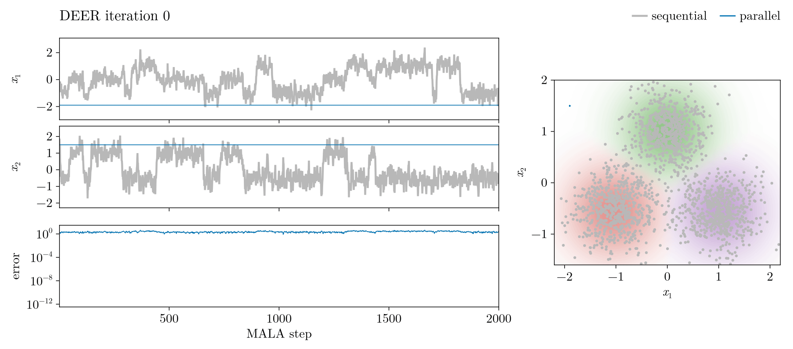
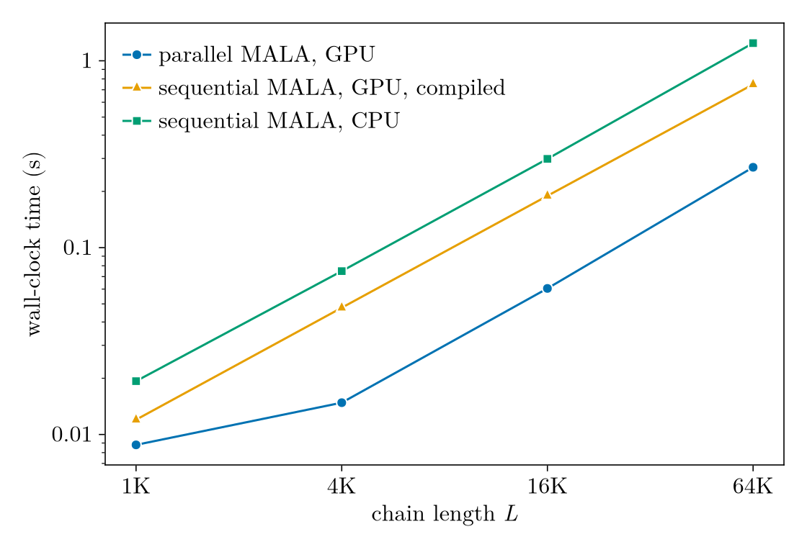

# ParallelMCMC

<p align="center">
  
</p>

[](https://rsenne.github.io/ParallelMCMC.jl/stable)
[](https://rsenne.github.io/ParallelMCMC.jl/dev)
[](https://github.com/rsenne/ParallelMCMC.jl/actions/workflows/Test.yml?query=branch%3Amain)
[](https://codecov.io/gh/rsenne/ParallelMCMC.jl)
[](https://github.com/rsenne/ParallelMCMC.jl/actions/workflows/Docs.yml?query=branch%3Amain)
[](CODE_OF_CONDUCT.md)
[](#contributors)
[](https://github.com/JuliaBesties/BestieTemplate.jl)

<p align="center">
  
</p>

<p align="center">
  <em>DEER on a 2,000-step MALA chain targeting a mixture of three Gaussians placed like the Julia logo. The grey sequential chain and the blue parallel iterate share the same random numbers, and the bottom panel shows the distance between them at every step.</em>
</p>

## What this package does

ParallelMCMC.jl parallelizes Markov chain Monte Carlo *within* a single chain.
Its main sampler draws the random numbers for a block of MALA transitions in advance, then solves for every state in the block at once with DEER.
This pays off when evaluating the target and its derivatives is expensive enough to keep parallel hardware busy.
For small targets on a CPU, ordinary sequential MALA is usually faster.

The method is described in:

> Zoltowski, D. M., Wu, S., Gonzalez, X., Kozachkov, L., & Linderman, S. W. (2025).
> **Parallelizing MCMC Across the Sequence Length.** *NeurIPS 2025.*
> [arXiv:2508.18413](https://arxiv.org/abs/2508.18413)

## Example: German Credit

We repeat the Bayesian logistic regression of Zoltowski et al. (2025, Section 5.2) on the German Credit data, with whitened covariates, an intercept, and a $\mathcal{N}(0, I)$ prior, so the posterior has 25 dimensions.
Each method draws one chain of $L$ samples with step size $\varepsilon = 0.0015$, which accepts about 85% of proposals.
`ParallelMALASampler` solves the whole chain as one block, and its samples match the sequential chain step for step up to the solver tolerance of $5 \times 10^{-4}$.
The exception would be an accept decision that falls within that tolerance of the threshold and flips; none did in these runs, and the parallel chain stayed within $3 \times 10^{-4}$ of the sequential one at every $L$.
The model returns its log-density, gradient and Hessian-vector product from one `value_grad_hvp_batch` call, so each DEER iteration computes $X\beta$ once per state.

<p align="center">
  
</p>

We compare against two sequential baselines: `MALASampler` on the CPU, and the same chain compiled into one GPU program with Reactant, as the paper does with JAX.
At $L = 64\,000$ the parallel sampler is 4.6 times faster than the CPU chain and 2.8 times faster than the compiled GPU chain, which takes 12 µs per step.
These timings come from one NVIDIA H200 NVL and 8 cores of an AMD EPYC 9135 under Linux.
The paper's speedups of 20 to 30 times are for two chains at a time and about 10 for one, against a JAX loop that takes 19 to 28 µs per step on this GPU, depending on the JAX version.
The scripts are [`german_credit.jl`](benchmarks/ParallelMCMCBenchmarks/scripts/german_credit.jl) and [`german_credit_reactant.jl`](benchmarks/ParallelMCMCBenchmarks/scripts/german_credit_reactant.jl).

## Samplers

| Sampler | Role |
|---|---|
| [`ParallelMALASampler`](https://rsenne.github.io/ParallelMCMC.jl/dev/95-reference/#ParallelMCMC.ParallelMALASampler) | MALA parallelized within the chain with DEER |
| [`AdaptiveMALASampler`](https://rsenne.github.io/ParallelMCMC.jl/dev/95-reference/#ParallelMCMC.AdaptiveMALASampler) | Sequential MALA with step-size adaptation |
| [`MALASampler`](https://rsenne.github.io/ParallelMCMC.jl/dev/95-reference/#ParallelMCMC.MALASampler) | Sequential MALA with a fixed step size |

All three implement the [AbstractMCMC](https://github.com/TuringLang/AbstractMCMC.jl) interface and return [FlexiChains](https://pysm.dev/FlexiChains.jl) objects.

## Quick start

Install ParallelMCMC from the Julia REPL by pressing `]` and running:

```julia-repl
pkg> add ParallelMCMC
```

```julia
using ParallelMCMC, Random

logdensity(x) = -sum(abs2, x) / 2
gradient(x) = -x
hvp(x, v) = -v

model = DensityModel(logdensity, gradient, 2; hvp=hvp, param_names=[:x1, :x2])
sampler = ParallelMALASampler(0.5; T=64)
chain = sample(MersenneTwister(42), model, sampler, 1_000; initial_params=zeros(2))
```

`hvp(x, v)` returns $\nabla^2 \log p(x)\, v$, which DEER uses to linearize each MALA transition.
The Hessian of a standard normal is $-I$, so here it is just `-v`.

The [documentation](https://rsenne.github.io/ParallelMCMC.jl/dev/) covers step-size tuning, AD backends, GPU execution, and how DEER works.

## How to cite

If you use ParallelMCMC.jl in your work, please cite using the reference given in [CITATION.cff](https://github.com/rsenne/ParallelMCMC.jl/blob/main/CITATION.cff).

## Contributing

If you want to contribute, start with the [contributing guide on GitHub](docs/src/90-contributing.md) or the [documentation site](https://rsenne.github.io/ParallelMCMC.jl/dev/90-contributing/).

---

### Contributors

<!-- ALL-CONTRIBUTORS-LIST:START - Do not remove or modify this section -->
<!-- prettier-ignore-start -->
<!-- markdownlint-disable -->
<table>
  <tbody>
    <tr>
      <td align="center" valign="top" width="14.28%"><a href="https://github.com/rsenne"><br /><sub><b>Ryan Senne</b></sub></a><br /><a href="#code-rsenne" title="Code">💻</a> <a href="#maintenance-rsenne" title="Maintenance">🚧</a> <a href="#test-rsenne" title="Tests">⚠️</a> <a href="#ideas-rsenne" title="Ideas, Planning, & Feedback">🤔</a> <a href="#review-rsenne" title="Reviewed Pull Requests">👀</a> <a href="#doc-rsenne" title="Documentation">📖</a></td>
      <td align="center" valign="top" width="14.28%"><a href="https://github.com/penelopeysm"><br /><sub><b>Penelope Yong</b></sub></a><br /><a href="#code-penelopeysm" title="Code">💻</a> <a href="#test-penelopeysm" title="Tests">⚠️</a> <a href="#ideas-penelopeysm" title="Ideas, Planning, & Feedback">🤔</a> <a href="#review-penelopeysm" title="Reviewed Pull Requests">👀</a> <a href="#doc-penelopeysm" title="Documentation">📖</a></td>
      <td align="center" valign="top" width="14.28%"><a href="https://gdalle.github.io/"><br /><sub><b>Guillaume Dalle</b></sub></a><br /><a href="#review-gdalle" title="Reviewed Pull Requests">👀</a> <a href="#ideas-gdalle" title="Ideas, Planning, & Feedback">🤔</a></td>
      <td align="center" valign="top" width="14.28%"><a href="http://wsmoses.com"><br /><sub><b>William Moses</b></sub></a><br /><a href="#review-wsmoses" title="Reviewed Pull Requests">👀</a></td>
    </tr>
  </tbody>
</table>

<!-- markdownlint-restore -->
<!-- prettier-ignore-end -->

<!-- ALL-CONTRIBUTORS-LIST:END -->
