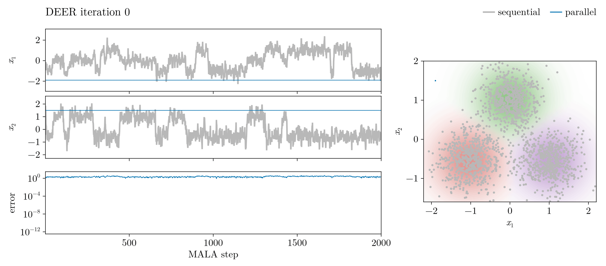

```@meta
CurrentModule = ParallelMCMC
```

# ParallelMCMC.jl

```@raw html
<p align="center">
  
</p>
```

ParallelMCMC.jl parallelizes Markov chain Monte Carlo (MCMC) *within* a single chain.
Its main sampler, [`ParallelMALASampler`](@ref), draws the random numbers for a block of MALA transitions in advance (so the block becomes a deterministic recursion).
It then solves for all states in the block at once with DEER, a Newton method whose linear solves are parallel scans.
Running several chains at once also works, but it is experimental (see [Run several chains](10-getting-started.md#Run-several-chains)).

Parallel MALA does more total work than sequential MALA, so it finishes sooner only when the hardware can run that work in parallel.
In practice that means using a GPU such as an L40S or H100.
On the CPU, the DEER solve runs on a single thread, so expect speedups there only if a batched log density hands most of the work to multithreaded BLAS.
The speedup depends on the target, the block length `T`, the AD backend, and the hardware.

```@raw html
<p align="center">
  
</p>
<p align="center">
  <em>DEER on a 2,000-step MALA chain targeting a mixture of three Gaussians placed like the Julia logo. The grey sequential chain and the blue parallel iterate share the same random numbers, and the bottom panel shows the distance between them at every step.</em>
</p>
```

## Which sampler to use

| If you want to... | Start with... |
|---|---|
| Try the parallel-across-sequence algorithm | [`ParallelMALASampler`](@ref) |
| Tune a step size automatically | [`AdaptiveMALASampler`](@ref) |
| Check a model against ordinary sequential MALA | [`MALASampler`](@ref) |
| Run a large, batch-friendly target on a GPU | [GPU execution](15-gpu.md) |

## Install

ParallelMCMC supports Julia 1.10 and later.

```julia-repl
pkg> add ParallelMCMC
```

ParallelMCMC has no hard dependency on any AD or GPU package, so you only need to load the ones your model needs, if any at all.
The example below writes its derivatives by hand and needs only ParallelMCMC.

## A complete first run

The target is a two-dimensional standard normal, $\log p(x) = -\tfrac{1}{2}\|x\|^2$.
MALA uses its gradient, $\nabla \log p(x) = -x$, to propose each move.
DEER also needs the derivative of each MALA transition, which involves the Hessian $\nabla^2 \log p(x)$.
It never builds the Hessian, though, and only multiplies it by probe vectors.
So instead of a Hessian, the model takes a Hessian-vector product (HVP) `hvp(x, v)`, which returns $\nabla^2 \log p(x)\, v$ for whatever vector $v$ the sampler passes in.
The Hessian of a standard normal is $-I$ at every $x$, so the HVP is just $-v$.

```@example index
using ParallelMCMC, Random

logdensity(x) = -sum(abs2, x) / 2
gradient(x) = -x
hvp(x, v) = -v

model = DensityModel(logdensity, gradient, 2; hvp=hvp, param_names=[:x1, :x2])
sampler = ParallelMALASampler(0.5; T=64)
chain = sample(MersenneTwister(42), model, sampler, 1_000; initial_params=zeros(2))
```

`0.5` is the MALA step size, and `T=64` makes DEER solve 64 transitions at a time.
`T` does not change the length of the chain: `sample` still returns 1,000 samples.
The draws should have a mean near 0 and a standard deviation near 1:

```@example index
using Statistics
mean(chain[:x1]), std(chain[:x1])
```

When the derivatives are tedious to write by hand, an AD backend can compute the gradient and the HVP instead; see [Defining models](12-models.md).

## Where to go next

- [Getting started](10-getting-started.md) walks through step-size tuning, running parallel MALA, and reading the result.
- [Defining models](12-models.md) covers hand-written derivatives, automatic differentiation, batched functions, parameter names, and LogDensityProblems models.
- [GPU execution](15-gpu.md) explains when a GPU is worthwhile and shows a complete logistic-regression example.
- [Troubleshooting](16-troubleshooting.md) covers common errors and failure modes.
- [How the algorithm works](20-algorithms.md) develops the DEER update and the diagonal parallel scan.
- [API reference](95-reference.md) lists constructors and low-level building blocks.

## Citation

The parallel-across-sequence method is described in:

> Zoltowski, D. M., Wu, S., Gonzalez, X., Kozachkov, L., & Linderman, S. W.
> (2025). *Parallelizing MCMC Across the Sequence Length*. NeurIPS 2025.
> [arXiv:2508.18413](https://arxiv.org/abs/2508.18413)

If you use ParallelMCMC.jl in published work, please use the package citation in [`CITATION.cff`](https://github.com/rsenne/ParallelMCMC.jl/blob/main/CITATION.cff).
